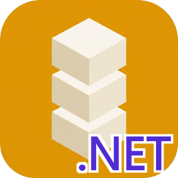

# Identisure C# / .NET Client

[![NuGet version][nuget-image]][nuget-url]
[![Documentation][docs-image]][docs-url]
[![MIT license][license-image]][license-url]

[nuget-image]: https://img.shields.io/nuget/v/Identisure.Client?style=flat-square
[nuget-url]: https://www.nuget.org/packages/Identisure.Client
[docs-image]: https://img.shields.io/badge/github-docs-orange?logo=github&style=flat-square
[docs-url]: https://identisure.github.io/api-client-csharp
[license-image]: https://img.shields.io/badge/license-MIT-blue?style=flat-square
[license-url]: https://opensource.org/license/mit

API client for the [Identisure](https://developers.identisure.com) REST API.

Documentation: [identisure.github.io/api-client-csharp](https://identisure.github.io/api-client-csharp)

## Requirements

.NET 8 or later.

## Supported providers

- **BankID SE**: auth, sign, phone auth and sign, QR verify, age verification
- **BankID NO**: auth, backchannel auth, sign, age verification
- **Freja eID**: auth, backchannel auth, sign, backchannel sign, age verification
- **MitID**: auth, backchannel auth, sign, age verification
- **FTN** (Finnish Trust Network): auth, age verification
- **Vipps MobilePay**: auth, backchannel auth
- **Documents**: upload and download documents for signing

## Installation

```sh
dotnet add package Identisure.Client
```

## Usage

```csharp
using Identisure.Client;
using Identisure.Client.Models;

var client = new IdentisureClientBuilder("client_id", "client_secret")
    .Environment(IdentisureEnvironment.Staging)
    .Build();

var session = await client.BankIdSe.AuthAsync(new BankIdSeAuthRequest());
if (session is BankIdSePending pending)
{
    Console.WriteLine($"Session ID: {pending.Id}");

    var result = await client.BankIdSe.WaitForAuthAsync(pending.Id);
    switch (result)
    {
        case BankIdSeCompleted done:
            Console.WriteLine($"Authenticated: {done.Name} ({done.Ssn})");
            break;
        case BankIdSeFailed failed:
            Console.WriteLine($"Failed: {failed.Error}");
            break;
    }
}
```

### Verifying callbacks

Verify the `X-Signature-SHA256` header against the raw request body before parsing it:

```csharp
var valid = CallbackSignature.Verify(rawBody, signatureHeader, "hmac_secret");
```

## Development

### Prerequisites

- [.NET 8 SDK](https://dotnet.microsoft.com/)

The tests use shared fixtures from a git submodule. Clone with `--recurse-submodules`, or run
`git submodule update --init` in an existing clone.

### Build

```sh
dotnet build Identisure.Client.sln
```

### Test

```sh
dotnet test Identisure.Client.sln
```

### Release

Set the version in `src/Identisure.Client/Identisure.Client.csproj` and `src/Identisure.Client/Transport.cs` and commit. Then push a tag:

```sh
git tag v0.1.0
git push origin v0.1.0
```

The release workflow checks that the tag matches the version, runs CI, publishes to NuGet and creates a GitHub release.

## Other languages

[Dart](https://github.com/identisure/api-client-dart), [Go](https://github.com/identisure/api-client-go), [TypeScript/JavaScript](https://github.com/identisure/api-client-js), [Java/Kotlin](https://github.com/identisure/api-client-jvm), [PHP](https://github.com/identisure/api-client-php), [Python](https://github.com/identisure/api-client-py), [Ruby](https://github.com/identisure/api-client-ruby), [Rust](https://github.com/identisure/api-client-rust), [Swift](https://github.com/identisure/api-client-swift)
